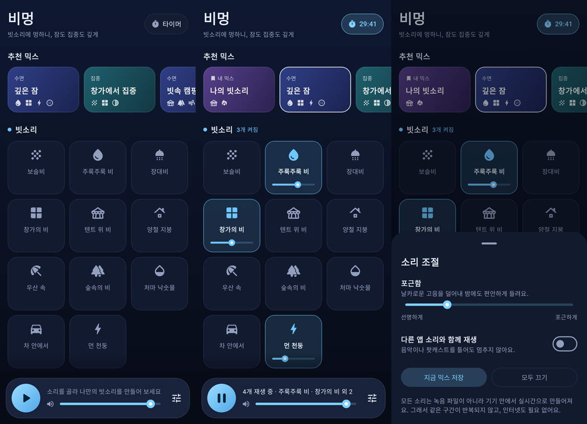

# 비멍 — 빗소리 · ASMR 믹서

비 오는 날 창밖을 멍하니 바라보는 것처럼, 여러 빗소리를 겹쳐 놓고 잠들거나 집중할 수 있게 해 주는 안드로이드 앱입니다.



## 설치

1. 안드로이드 폰에서 [`dist/bimeong-1.0.0.apk`](dist/bimeong-1.0.0.apk)를 내려받습니다.
2. 파일을 열고, "출처를 알 수 없는 앱 설치"를 허용한 뒤 설치합니다.

안드로이드 8.0 이상에서 동작합니다. 용량은 약 1.5MB이고 인터넷 연결이 필요 없습니다.

## 할 수 있는 것

- **소리 32가지를 자유롭게 겹치기** — 타일을 누르면 켜지고, 타일 안의 슬라이더로 소리마다 크기를 맞춥니다.
- **추천 믹스 14가지** — 깊은 잠, 빗속 캠핑, 창가에서 집중, 딥 포커스, 모닥불 옆, 여름밤 시골 등. 한 번 눌러 바로 재생합니다.
- **내 믹스 저장** — 마음에 드는 조합에 이름을 붙여 저장해 두고 다시 부릅니다. (길게 누르면 삭제)
- **수면 타이머** — 15분~3시간. 끝나기 전 마지막 1분 동안 소리가 서서히 작아지며 꺼집니다.
- **집중 타이머** — 집중 15/25/45/50분, 휴식 5/10/15분을 번갈아 가며, 바뀔 때마다 부드러운 종소리가 울립니다.
- **포근함 조절** — 날카로운 고음을 덜어내 밤에 듣기 편한 소리로 바꿉니다.
- **화면을 꺼도 계속 재생** — 알림과 잠금 화면에서 일시정지·끄기를 할 수 있습니다.
- 이어폰이 빠지면 자동으로 멈추고, 전화가 오면 멈췄다가 끝나면 다시 재생합니다.
- 음악이나 팟캐스트와 함께 틀 수 있습니다. (소리 조절 → 다른 앱 소리와 함께 재생)

### 소리 목록

| 분류 | 소리 |
|---|---|
| 빗소리 | 보슬비, 주룩주룩 비, 장대비, 창가의 비, 텐트 위 비, 양철 지붕, 우산 속, 숲속의 비, 처마 낙숫물, 차 안에서, 먼 천둥 |
| 자연 | 파도, 시냇물, 바람, 모닥불, 풀벌레, 새소리, 개구리 |
| ASMR · 공간 | 고양이 골골송, 키보드, 연필 사각사각, 시계 초침, 풍경, 싱잉볼, 심장 박동, 밤기차, 선풍기, 탄산 방울 |
| 노이즈 | 백색소음, 핑크 노이즈, 브라운 노이즈, 그린 노이즈 |

## 소리를 만드는 방식

녹음 파일을 반복 재생하지 않습니다. 모든 소리는 폰 안에서 **실시간으로 합성**됩니다.

- 빗소리는 세 겹으로 이루어집니다. 멀리서 떨어지는 수많은 빗방울이 만드는 바탕 소리, 그 위에 흩뿌려지는 자잘한 타격음, 그리고 가까이 떨어지는 빗방울 하나하나입니다.
- 가까운 빗방울은 떨어지는 곳에 따라 다르게 만들어집니다. 고인 물에 떨어지면 공기 방울이 울리며 음이 살짝 올라가고, 유리창은 짧게 "톡", 팽팽한 텐트 천은 낮게 "툭", 양철 지붕은 판 고유의 울림으로 "탱" 하고 울립니다.
- 빗줄기는 바람결에 따라 천천히 굵어졌다 가늘어집니다.
- 같은 구간이 다시 돌아오지 않으므로 반복되는 이음매가 들리지 않고, 앱 용량도 작습니다.
- 모든 소리는 같은 슬라이더 위치에서 비슷한 크기로 들리도록 음량이 맞춰져 있습니다.

## 직접 빌드하기

안드로이드 SDK(플랫폼 36)와 JDK 17 이상이 필요합니다.

```bash
./gradlew :app:assembleRelease      # APK: app/build/outputs/apk/release/app-release.apk
./gradlew :engine:test :app:testDebugUnitTest   # 테스트
```

릴리스 서명 키는 저장소에 들어 있지 않습니다. `signing/keystore.properties`가 없으면 디버그 키로 서명됩니다.
자신의 키로 서명하려면 키스토어를 `signing/`에 두고 아래 내용으로 `signing/keystore.properties`를 만듭니다.

```properties
storeFile=my-release.jks
storePassword=...
keyAlias=...
keyPassword=...
```

> 서명 키가 다른 APK는 기존 앱 위에 덮어 설치되지 않습니다. 다른 키로 빌드한 새 버전을 설치하려면 먼저 기존 앱을 삭제해야 합니다.

## 구조

| 위치 | 내용 |
|---|---|
| `engine/` | 순수 Kotlin 소리 엔진. 안드로이드에 의존하지 않아 PC에서 테스트하고 WAV로 뽑아 볼 수 있습니다. |
| `engine/.../Dsp.kt` | 필터, 노이즈, 그레인(짧게 울리는 소리 알갱이) 등 기본 부품 |
| `engine/.../RainVoices.kt`, `NatureVoices.kt`, `AsmrVoices.kt` | 소리 하나하나의 합성 모델 |
| `engine/.../Mixer.kt` | 소리를 섞고, 페이드·리버브·음색·리미터를 처리 |
| `app/.../audio/` | `Player`(재생 상태·타이머·저장), `AudioOutput`(오디오 출력 스레드), `PlaybackService`(백그라운드 재생·알림) |
| `app/.../ui/` | Jetpack Compose 화면 |

### 소리 손보기

소리를 고친 뒤에는 PC에서 바로 들어 볼 수 있습니다.

```bash
./gradlew :engine:renderSamples -Pout=$PWD/samples -Pseconds=20                 # 앱에서 들리는 그대로, 소리마다 WAV 하나
./gradlew :engine:renderSamples -Pout=$PWD/samples -Pseconds=20 -Ponly=rain_tent
```

합성 모델을 바꿔 소리 크기가 달라졌다면 음량 보정값을 다시 계산합니다. (Python, ffmpeg 필요)

```bash
mkdir -p raw
./gradlew -q :engine:renderSamples -Pout=$PWD/raw -Pseconds=60 -Pmode=raw > raw/stats.csv
python3 tools/calibrate.py raw engine/src/main/kotlin/app/bimeong/engine/Catalog.kt
```
