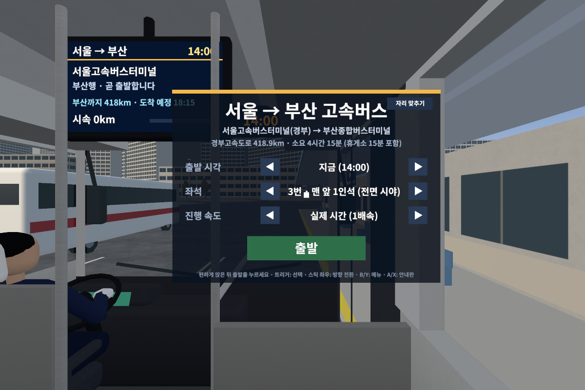
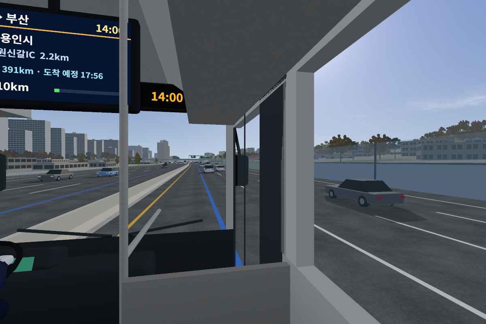
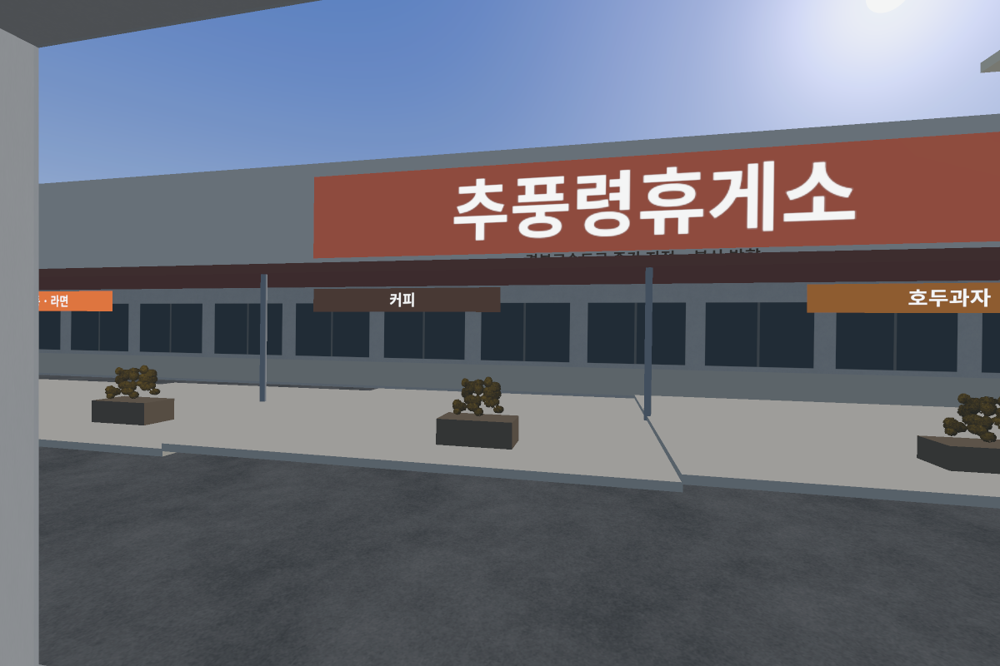
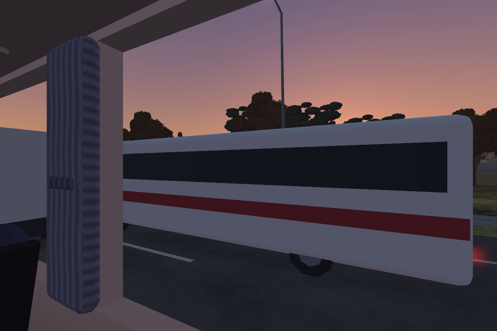

# 서울 → 부산 고속버스 VR (Meta Quest 3)

서울고속버스터미널(경부선)에서 부산종합버스터미널(노포동)까지, 우등 고속버스 좌석에 앉아 **실제 시간표 그대로 4시간 15분** 동안 창밖을 보며 가는 VR 앱입니다.

- 설치 파일: [`dist/SeoulBusanBusVR.apk`](dist/SeoulBusanBusVR.apk) (약 25MB, Meta Quest 2 / Pro / 3 / 3S)
- 네이티브 OpenXR 앱 (C++ / OpenGL ES 3, 멀티뷰 스테레오 렌더링, 72Hz)

| 서울 터미널 · 출발 메뉴 | 경부고속도로 (용인) |
|---|---|
|  |  |
| **추풍령휴게소 15분 정차** | **구미 부근의 노을** |
|  |  |

(헤드셋 없이 같은 렌더링 코드를 PC에서 돌려 뽑은 화면입니다.)

## 무엇이 실제와 같은가

| 항목 | 내용 |
|---|---|
| 경로 | 실제 도로 데이터로 계산한 418.9km: 신반포로 → 사평대로 → 반포IC → **경부고속도로 전 구간** → 노포IC → 중앙대로 → 터미널 |
| 시간 | 총 4시간 15분 (추풍령휴게소 15분 정차 포함). 고속도로 순항 약 시속 110km |
| 지형 | Copernicus 30m 수치표고모델. 청계산·추풍령·금오산·영남알프스·금정산 능선이 실제 위치에 보입니다 |
| 토지 | ESA WorldCover 10m 토지피복 → 숲·논밭·시가지·강이 실제 위치에 배치 |
| 건물 | 경로 4km 이내 실제 건물 30만 동의 위치·크기·방향 (높이 정보가 없는 건물은 추정) |
| 도로 | 교량 118곳·터널 9곳, 나들목·분기점·휴게소 68곳의 실제 이름 표지판, 교차하는 도로·고가도로·램프 |
| 하늘 | 날짜·시각·위도에 맞춘 태양 위치 → 노을·밤·별, 가로등과 불 켜진 창문 |
| 계절 | 기기 날짜의 달에 따라 숲·논밭 색이 바뀝니다 |

실사 영상이 아니라 실제 데이터 위에 절차적으로 만든 3D 풍경입니다. 건물 외관·나무·차량은 단순화된 모델입니다.

## 설치 (사이드로드)

1. 휴대폰 Meta Horizon 앱에서 헤드셋의 **개발자 모드**를 켭니다.
2. PC와 USB로 연결하고 헤드셋에서 USB 디버깅을 허용합니다.
3. 아래 중 하나로 설치합니다.
   - `adb install -r SeoulBusanBusVR.apk`
   - Meta Quest Developer Hub 또는 SideQuest에 APK 파일을 끌어다 놓기
4. 헤드셋 **앱 라이브러리 → 알 수 없는 출처**에서 "서울→부산 고속버스 VR"을 실행합니다.

## 타는 법

1. 의자에 편하게 앉은 뒤, 컨트롤러로 메뉴의 **출발**을 누릅니다. 누르는 순간의 머리 위치가 좌석 위치가 됩니다.
2. 출발 시각(지금 / 06:30 ~ 22:00), 좌석(5곳), 진행 속도(실제 시간 / 4·16·60배속)를 고를 수 있습니다.

| 조작 | 동작 |
|---|---|
| 트리거 | 메뉴 선택 |
| 스틱 좌우 | 시선 방향 30° 전환 (창밖을 정면으로 보기) |
| B / Y / 메뉴 버튼 | 운행 중 메뉴 열기·닫기 (좌석 변경, 배속, 안내판, 끝내기) |
| A / X | 좌석 앞 모니터 접기·펴기 |

컨트롤러가 없으면 버튼을 1.4초 바라보는 것으로 선택됩니다.

### 좌석 앞 모니터에서 APK 쓰기

좌석 바로 앞(앞좌석 등받이)에 모니터가 붙어 있습니다. 헤드셋에 설치된 2D 앱이 아이콘으로 나오고, 직접 설치한 APK에는 노란 `APK` 표시가 붙습니다. 앱을 고르면 **그 앱이 버스 안 모니터 화면에서 실행되고**, 창밖 풍경은 그대로 흘러갑니다.

| 모니터 조작 | 동작 |
|---|---|
| 화면을 가리키고 트리거 | 터치 (누른 채 움직이면 끌기) |
| 가리킨 채 스틱 위·아래 | 스크롤 |
| 아래 버튼 | ◀ 뒤로 · 앱 목록 · × 앱 닫기 |
| A / X | 모니터 접기·펴기 |

**처음 한 번만 설정 (헤드셋 안에서, PC 없이)**

Quest는 일반 앱이 다른 앱 화면을 자기 안에 띄우는 것을 막아 둡니다. 그래서 모니터 도우미가 필요합니다. 도우미는 이 APK 안에 들어 있고, 헤드셋의 Android **무선 디버깅** 권한으로 앱을 모니터에 띄워 줍니다. 버스 앱이 이 무선 디버깅에 스스로 연결할 수 있도록 **처음에 딱 한 번** 허락해 두면, 그다음부터는 버스 앱이 켜질 때마다 혼자 도우미를 켭니다. 헤드셋을 껐다 켜도 다시 할 필요가 없습니다.

1. Wi-Fi를 켜 둡니다.
2. 좌석 모니터에서 **처음 한 번 설정하기 → 설정 열기**를 누르면 2D 창 두 개가 뜹니다: Android 설정과 '좌석 모니터 설정'. 이때만 잠깐 버스 밖 화면이 됩니다.
3. 설정 창에서 **무선 디버깅**을 켜고, 그 안의 **페어링 코드로 기기 페어링**을 누르면 6자리 숫자가 나옵니다. 개발자 옵션이 안 보이면 '휴대전화 정보 > 빌드 번호'를 7번 누릅니다.
4. '좌석 모니터 설정' 창에 그 숫자를 넣고 **연결하기**를 누릅니다. '완료'가 나오면 **버스로 돌아가기**를 누릅니다.

이후에는 버스 앱이 무선 디버깅을 잠깐 켜서 도우미를 켜고 다시 끕니다. 모니터 위쪽에 `도우미 켜는 중…` → `APK 실행 준비됨`이 표시됩니다. Wi-Fi가 꺼져 있으면 자동으로 켜지 못합니다.

PC가 있다면 위 설정 대신 헤드셋을 켤 때마다 아래 명령으로 도우미를 켤 수도 있습니다.
```
adb shell sh /sdcard/Android/data/kr.busvr.seoulbusan/files/start.sh
```

**한계**
- VR 전용 앱은 모니터에 띄울 수 없습니다. 모니터 목록에서는 빠집니다.
- 모니터 안 앱에서 글자 입력(키보드)은 아직 안 됩니다.
- 화면 캡처를 막는 앱(넷플릭스 등 DRM 영상)은 검게 나올 수 있습니다.

**배터리**: Quest 3 배터리는 약 2시간이라 전 구간을 타려면 충전 케이블을 연결하세요. 진행 위치는 15초마다 저장되고, 앱을 다시 켜면 **이어서 타기**로 계속할 수 있습니다.

## 폴더 구성

```
busvr/
  dist/SeoulBusanBusVR.apk   설치 파일
  src/                       C++ 소스 (엔진, 세계 생성, 버스, 교통, UI, OpenXR)
  assets/                    구워진 데이터 (경로·지형·건물·도로·텍스처·글꼴)
  android/                   Gradle 프로젝트 (APK 빌드)
  tools/                     데이터 파이프라인 (Python)
  build_desktop.sh           헤드셋 없이 화면을 PNG로 뽑는 검증용 빌드
```

## 다시 빌드하기

```bash
# APK (Android SDK, NDK 27.2, CMake 3.22 필요)
cd busvr/android && gradle assembleRelease
# 결과: app/build/outputs/apk/release/app-release.apk (디버그 키 서명, 바로 설치 가능)

# PC 검증용 (Mesa 소프트웨어 렌더러)
cd busvr && ./build_desktop.sh
./build/busvr_desktop --km 207.4 --seat 1 --yaw -75 --out shot.png   # 추풍령휴게소
./build/busvr_desktop --simulate 1                                   # 전 구간 시간표 검증
```

데이터를 처음부터 다시 만들려면 `tools/`의 스크립트를 순서대로 실행합니다
(`overture_roads.py` → `build_route.py` → `overture_buildings.py` → `bake_dem.py` → `bake_route.py` → `bake_world.py` → `bake_textures.py` → `bake_font.py`).

## 알려진 한계

- **실제 Quest 3 기기에서는 실행해 보지 못했습니다.** 같은 렌더링 코드를 PC 소프트웨어 렌더러로 돌려 화면을 확인했고, OpenXR 부분은 표준 절차대로 작성했지만 기기 테스트는 거치지 않았습니다.
- 안내 방송 음성은 없습니다 (차임벨 + 화면 안내문). 엔진·노면·바람·터널 소리는 합성음입니다.
- 추풍령휴게소만 정차 장소로 만들어져 있고, 다른 휴게소는 표지판만 있습니다.
- 터널·교량·휴게소 이름 중 일부, 차로 수, 방음벽 위치는 실제와 다를 수 있습니다.

## 포함한 오픈소스

- [libadb-android](https://github.com/MuntashirAkon/libadb-android) (Apache-2.0 또는 GPL-3.0-or-later 중 Apache-2.0 적용): 헤드셋 자신의 무선 디버깅에 연결하는 ADB 클라이언트. `android/app/src/main/java/io/github/muntashirakon/adb`
- [spake2-java](https://github.com/MuntashirAkon/spake2-java) (LGPL-3.0): 무선 디버깅 페어링용 SPAKE2. `android/app/src/main/java/io/github/muntashirakon/crypto`
- Bouncy Castle (MIT), Conscrypt (Apache-2.0)
- 라이선스 전문: `third_party_licenses/`

## 데이터 출처

- 도로·건물: [Overture Maps](https://overturemaps.org) (OpenStreetMap 기여자 포함, ODbL / CDLA)
- 지형: Copernicus DEM GLO-30 (© DLR e.V. 2010-2014, © Airbus Defence and Space GmbH 2014-2018, ESA 제공)
- 토지피복: ESA WorldCover 2021 v200 (CC BY 4.0)
- 글꼴: Noto Sans CJK KR (SIL OFL 1.1)
- OpenXR 로더: Khronos Group (Apache 2.0), stb_image (public domain)
