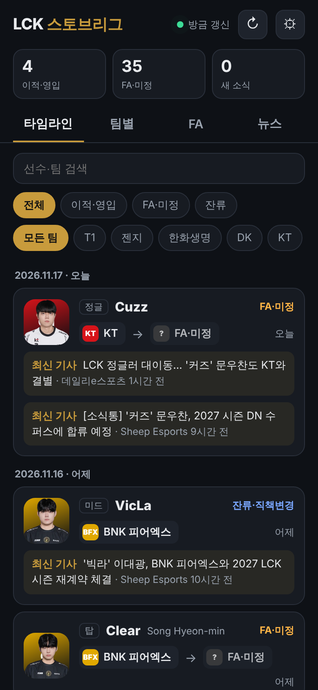

# LCK 스토브리그 (안드로이드 앱)

LCK 오프시즌 이적·영입·FA 현황을 실시간으로 확인하는 안드로이드 앱입니다.



## 설치
1. 폰에서 [`release/lck-stove.apk`](release/lck-stove.apk) 를 내려받습니다.
2. 열어서 설치합니다. ("출처를 알 수 없는 앱" 설치 허용이 필요할 수 있습니다.)
3. 처음 실행할 때 알림 권한을 허용하면, 앱이 꺼져 있어도 새 로스터 변동을 알려줍니다.

## 기능
- **타임라인**: 선수 사진과 함께 최신 상태(이적 / 영입 / FA·미정 / 잔류)를 날짜순으로. 위키보다 빠른 소식을 위해 그 선수 관련 **최신 기사**(한글 본명으로 매칭)를 카드에 함께 표시. 팀·종류 필터, 검색. 카드를 누르면 Leaguepedia 선수 페이지.
- **팀별**: LCK 10개 팀의 IN / OUT 목록과 위키에 등록된 현재 로스터.
- **FA**: 팀을 떠난 뒤 아직 새 팀 합류 기록이 없는 선수.
- **뉴스**: Google 뉴스에서 "LCK 스토브리그 / 영입 / 재계약 / FA" 최근 30일 기사. (재계약 소식은 로스터 기록에 잘 안 남아서 여기서 확인)
- 앱을 보고 있는 동안 3분마다 자동 새로고침 (위키 요청 한도를 넘지 않게 요청 간격 조절·변동 없으면 추가 조회 생략), 새 항목엔 NEW 표시.
- 백그라운드 알림: 약 15분마다 확인 (안드로이드 절전 정책에 따라 늦어질 수 있음).
- 설정: LCK 1군만 / 한국 팀 전체(LCK CL 포함), 집계 시작일, 알림·자동새로고침 켜기/끄기.

## 데이터 출처
- 로스터 변동·선수 사진: [Leaguepedia](https://lol.fandom.com) Cargo API (`RosterChanges`, `Teams`, `Players`, `PlayerImages` 테이블, CC BY-SA)
- 뉴스: Google 뉴스 RSS

위키 편집 시점에 따라 공식 발표보다 늦거나 빠를 수 있습니다.

## 빌드
JDK 17+ 와 Android SDK(platform 35) 필요.
```
echo "sdk.dir=/path/to/android-sdk" > local.properties
./gradlew assembleRelease
# → app/build/outputs/apk/release/app-release.apk
```
구조: Java 네이티브 셸(`MainActivity` WebView + HTTP 브리지, `WatchJob` 알림) + `app/src/main/assets/index.html` UI.
서명 키(`app/lck-stove.keystore`, 비밀번호 `lckstove1234`)는 개인 사이드로드용이라 저장소에 함께 둡니다.
